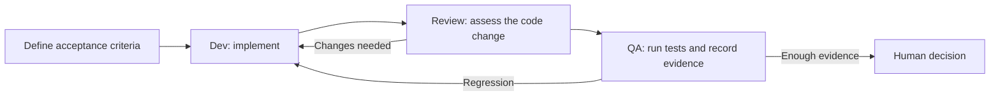

# Multi-agent architecture for software development and QA

[Leia em português](README.md) · [Joaquim Cartaxo's portfolio](https://joaquimcartaxoqa.github.io/en.html)

I use specialized agents to plan and implement software changes while keeping code review, testing, and evidence visible. This repository explains the approach through a real case and a simulated dashboard preview. It is not a runnable framework.

## How the work flows

*This diagram illustrates the workflow. The roles show responsibilities, not a transcript of a particular run.*

Evidence stays with the version it describes. If a test fails, the original result stays visible after the fix passes. If evidence is missing, the item stays open. This helps teams review changes by risk and tell the difference between an agent's claim and a recorded test result.

## Real case: JBC Marketing Digital

**Goal:** extend niche research while keeping sources traceable and enforcing query limits.

| Engineering decision | Recorded evidence |
| --- | --- |
| Separate implementation from review | Subagents worked through 11 tasks, with a review for each and changes requested on 2 |
| Expand evaluation of critical behaviors | The evaluation matrix grew from 35 to 45 checks. The versioned result recorded **45/45** with test fixtures and no live provider |
| Protect against regressions | The report recorded **331/331 tests** (up from 277), plus successful lint and build checks |
| Keep unverified work visible | A broader quality gate still had 16 items without evidence and was not considered passed |

The new checks covered cache reuse, query limits, and source traceability. This case summarizes private project records from November 21, 2026. It does not share JBC code, logs, or data. The software development subagents are separate from the product's marketing agents. These results do not validate the live provider or show a production rollout.

## Dev/QA dashboard preview

[PDF wireframe](demo/painel-dev-qa-wireframe.pdf) · [Sample JSON events](demo/painel-dev-qa-fixture.json)

The example shows a form that accepts February 31. The first test fails, Dev delivers a fix, and QA records the retest without removing the initial evidence. The wireframe and events are fictional. They are not part of the JBC case or a real agent run.
