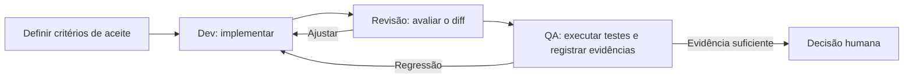

# Arquitetura multiagente para desenvolvimento de software e QA

[Read in English](README.en.md) · [Portfólio de Joaquim Cartaxo](https://joaquimcartaxoqa.github.io/#arquitetura-multiagente)

Uso agentes especializados para estruturar e implementar mudanças em projetos de software sem abrir mão de revisão, testes e evidências. Este repositório documenta a abordagem com um caso real e uma prévia visual simulada. Não é um framework executável.

## Como o trabalho flui

*Fluxo representativo. Os papéis ilustram responsabilidades, não uma transcrição de uma execução específica.*

A evidência acompanha a versão da mudança. Se um cenário falha, o registro da primeira tentativa não desaparece quando a correção passa. Se não há evidência suficiente, o item segue em aberto. Isso ajuda a revisar entregas por risco e a distinguir “o agente disse que passou” de “o teste registrou que passou”.

## Caso real: JBC Marketing Digital

**Objetivo:** ampliar a capacidade de pesquisa de nicho sem perder rastreabilidade das fontes ou ultrapassar os limites de consulta.

| Decisão de engenharia | Evidência registrada |
| --- | --- |
| Separar implementação de revisão | 11 tarefas executadas por subagentes, com revisão por tarefa e ajustes em 2 delas |
| Expandir a avaliação de comportamentos críticos | Matriz de 35 para 45 verificações. O artefato versionado registrou **45/45** com dados simulados e sem provedor real |
| Proteger contra regressões | O relatório registrou **331/331 testes** (antes: 277), além de lint e build concluídos |
| Manter visível o que ainda não foi validado | O gate mais amplo ainda tinha 16 itens sem evidência; não foi considerado aprovado |

As novas verificações cobriram reaproveitamento de pesquisas em cache, limites de consulta e rastreabilidade de fontes. O caso resume registros privados de 21 de novembro de 2026. Não divulga código, logs ou dados do JBC. Os subagentes de desenvolvimento são separados dos agentes de marketing do produto. Os resultados não validam o provedor externo real nem demonstram uma implantação em produção.

## Prévia do painel Dev/QA

[Wireframe em PDF](demo/painel-dev-qa-wireframe.pdf) · [Eventos de exemplo em JSON](demo/painel-dev-qa-fixture.json)

O cenário ilustrativo é um formulário que aceita `31/02`. A primeira tentativa falha, Dev entrega a correção e QA registra o reteste sem apagar a primeira evidência. O wireframe e os eventos são fictícios. Não correspondem ao caso JBC nem a uma execução real de agentes.
